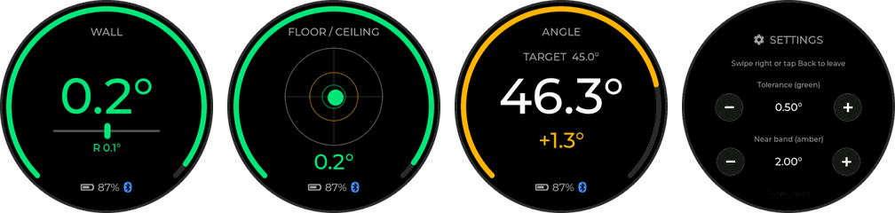
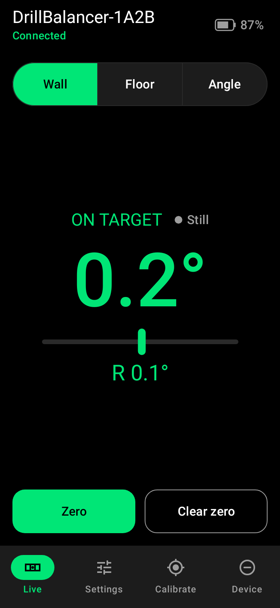
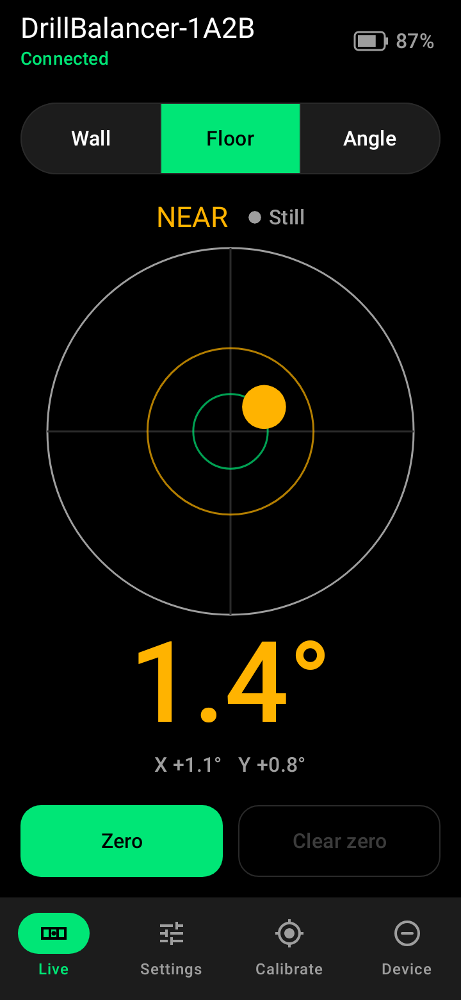
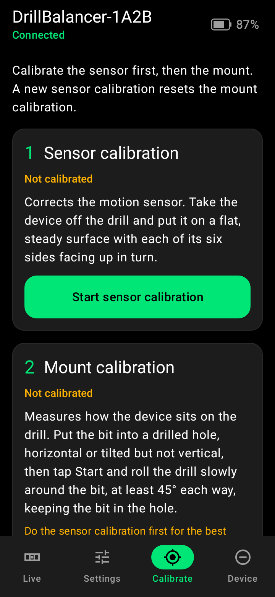
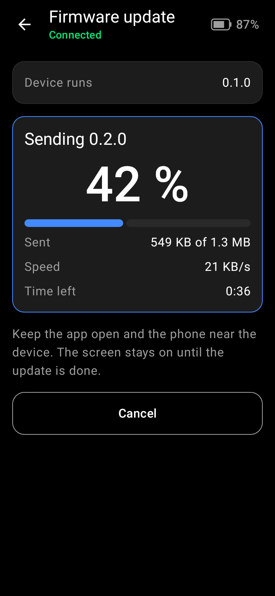
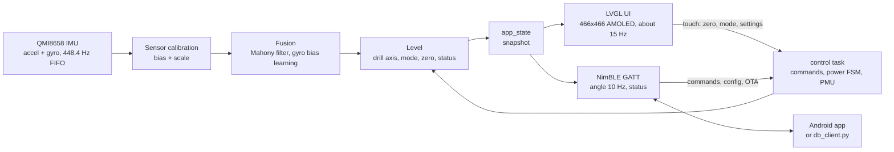

# DrillBalancer

A clip-on digital level for power drills. A round AMOLED board sits on the
back of the drill, faces you, and shows whether the bit is level, plumb or at
the angle you set. An Android app connects over Bluetooth LE for live
readings, settings, calibration and firmware updates.

> [!WARNING]
> **Status: pre-hardware.** The board has not arrived yet, and nothing in this
> repo has run on real hardware. The firmware is written, builds and passes
> its host tests on a PC. The Android app passes its JVM and screenshot tests
> and has been tested end-to-end on a real phone against the
> [PC simulator](firmware/tools/sim/README.md). Hardware bring-up will follow
> the [checklist in firmware/README.md](firmware/README.md#bring-up-checklist-hardware).
> Battery life, accuracy and OTA speed on the board are **not measured yet**.

<p align="center">
  
</p>
<p align="center"><sub>Device screens rendered on the PC from the real UI code
(<code>firmware/test_host/ui_preview</code>), with simulated readings. Not photos of hardware.</sub></p>

## Features

- **Three level modes**
  - **Wall**: elevation of the bit (up/down) plus left/right yaw against your
    zero, for horizontal holes.
  - **Floor / ceiling**: a 2D bubble for vertical holes, bit down or bit up.
  - **Angle**: elevation against a target angle (default 45°).
- **Tolerance colours**: green within the tolerance (default 0.5°), amber
  within the near band (default 2.0°), white outside.
- **Tap to zero** on the screen or in the app. Yaw comes from the gyro and
  drifts, so the screen warns you to re-zero after 60 s (adjustable).
- **Two calibrations**: a 6-position sensor (accelerometer) calibration and a
  mount calibration that finds the drill axis while you roll the drill with
  the bit in a hole.
- **Power management**: dims, then goes into deep sleep and wakes on motion;
  optional power-off after a time in sleep; power-off at low battery. A
  running drill held still keeps the screen on, for up to 3 min after the
  last touch or movement.
- **On-device settings** (hold 1 s) for tolerance, near band, target angle,
  brightness, timeouts and Bluetooth.
- **Bluetooth LE**: live angle and status notifications, settings as JSON,
  commands. Changes need a bonded link with LE Secure Connections and a
  6-digit passkey shown on the device.
- **Firmware update over BLE** with a SHA-256 check and automatic rollback
  if the new image fails its self-test at boot.
- **Android app** (Kotlin, Jetpack Compose) and a **Python BLE client**
  (`db_client.py`) for the same protocol.
- **PC simulator** that runs the firmware's own C logic on Linux and appears
  as a BLE device, so the app can be tested without the board.

<table>
  <tr>
    <td align="center"><br><sub>Live, wall mode</sub></td>
    <td align="center"><br><sub>Live, floor mode</sub></td>
    <td align="center"><br><sub>Calibrate</sub></td>
    <td align="center"><br><sub>Firmware update</sub></td>
  </tr>
</table>
<sub>App screenshots are the Roborazzi test baselines in <code>app/src/test/screenshots/</code>.
The values in them are test fixtures, not measurements.</sub>

## How it works



- The sensor task reads the IMU FIFO, applies the sensor calibration and runs
  the fusion on every sample. It publishes a reading at 50 Hz.
- The level component projects the "up" vector onto the drill axis (found by
  the mount calibration, nominally the board's -Z) and computes elevation,
  yaw and the bubble for the current mode.
- The UI and BLE only read snapshots and post commands (BLE config writes
  and the settings screen store their changes through one mutex-guarded
  `settings_update()`). One control task applies the commands, reloads the
  settings after every store and runs the power state machine.

Details: [Architecture](https://github.com/Tropaion/Drill_Balancer/wiki/Architecture).

## Hardware

| Part | Notes |
|---|---|
| [Waveshare ESP32-S3-Touch-AMOLED-1.75-B](https://www.waveshare.com/esp32-s3-touch-amoled-1.75.htm) | ESP32-S3R8, 16 MB flash, 8 MB PSRAM, 1.75" 466x466 CO5300 AMOLED, CST9217 touch, QMI8658 IMU, AXP2101 PMIC, USB-C |
| 1000 mAh LiPo, Sunkoo 803040 | Single cell, 2-wire (no NTC), MX1.25 (Micro JST 1.25) plug. The firmware charges it at 400 mA (cell maximum 500 mA), terminating at 25 mA / 4.2 V. |
| USB-C cable | Flashing, serial console and charging |
| Multimeter | To check the battery polarity before the first plug-in |
| A holder for the back of the drill | Screen facing you, bit along the board's -Z. No holder design is in this repo. |

> [!CAUTION]
> **Check the battery polarity with a multimeter before you plug the cell
> in.** LiPo plugs of the same shape come wired both ways, and reverse
> polarity can damage the board. See
> [Hardware](https://github.com/Tropaion/Drill_Balancer/wiki/Hardware).

## Quick start

### 1. Build and flash the firmware

Needs [ESP-IDF 5.5.1](https://docs.espressif.com/projects/esp-idf/en/v5.5.1/esp32s3/get-started/index.html)
installed at `~/esp/v5.5.1/esp-idf`. Run from the repo root (bash; in fish
keep the `bash -c` wrapper):

```sh
bash -c 'cd firmware && . ~/esp/v5.5.1/esp-idf/export.sh >/dev/null 2>&1 && idf.py build'
bash -c 'cd firmware && . ~/esp/v5.5.1/esp-idf/export.sh >/dev/null 2>&1 && idf.py -p /dev/ttyACM0 flash monitor'
```

Flashing and the console use the native USB-C port (`/dev/ttyACM0`). If the
port does not show up, hold BOOT and press RESET. On the first boot, look
for `DrillBalancer v...`, `QMI8658 6DOF 448.4 Hz` and `boot done` in the log.

### 2. Build and install the app

There is no release APK yet; build it from source. Needs the Android SDK
(platform `android-37`, build-tools 36) and any JDK 17+. Set `sdk.dir` in
`app/local.properties` or set `ANDROID_HOME`. Enable USB debugging on the
phone; `adb devices` must list it.

```sh
cd app
./gradlew installDebug
```

### 3. First use

1. Fix the board to the back of the drill, screen towards you.
2. **Sensor calibration**: hold the screen for 1 s to open Settings, tap
   *Calibrate sensor*, hold the device still on each of its six sides, then
   tap *Finish*.
3. **Mount calibration**: put the bit in a hole, tap *Calibrate mount*,
   *Start*, roll the drill slowly at least 45° each way, then *Finish*.
4. Hold the drill on your mark and **tap the screen to zero**. Swipe to
   change the mode.
5. In the app, tap your `DrillBalancer-XXXX`. On the first change it asks
   you to pair: enter the 6-digit code shown on the device.

Full guide: [Getting Started](https://github.com/Tropaion/Drill_Balancer/wiki/Getting-Started).

## Usage summary

**Gestures** ([Using the Device](https://github.com/Tropaion/Drill_Balancer/wiki/Using-the-Device))

| Gesture | Level screen | Settings |
|---|---|---|
| Tap | Zero (shows "ZERO") | Press a button |
| Swipe left / right | Next / previous mode | Right: back |
| Hold 1 s | Open Settings | Long press on a stepper repeats |
| Touch while dimmed | Only wakes the screen | Only wakes the screen |

**Modes**
- *Wall*: number = elevation, chevron = bit points up or down, bar = left/right
  yaw. "Yaw drifts: tap to re-zero" appears 60 s after the zero.
- *Floor / ceiling*: the bubble moves towards the higher side; the number is
  the total tilt.
- *Angle*: shows the target, the elevation and the signed difference.

**Calibration** ([Calibration](https://github.com/Tropaion/Drill_Balancer/wiki/Calibration))
- Do the sensor calibration first, then the mount calibration. A new sensor
  calibration resets the mount calibration.
- Both are stored in flash. The zero is not: it is lost on a reboot or a
  wake from deep sleep.

**Power** ([Power and Sleep](https://github.com/Tropaion/Drill_Balancer/wiki/Power-and-Sleep))
- Defaults: dim after 30 s, sleep after 120 s, power off after 60 min in
  sleep. Moving the drill wakes it from sleep.
- A running drill counts as activity for up to 3 min after the last touch
  or movement, so the screen stays on mid-hole. Vibration alone never keeps
  it awake: put away in a running van, it sleeps within 3 min + the sleep
  time. Turning the drill always counts, also while the motor runs; so does
  the van turning a corner.
- PWR key: short press = sleep, hold 1.5 s = power off. The key cannot wake
  the device from deep sleep; move it instead.

## Repository layout

```text
.
├── firmware/                ESP-IDF 5.5.1 firmware (C11; C++ only for XPowersLib)
│   ├── main/                app_main.c (boot), control.c (commands, power), sensor_task.c
│   ├── components/
│   │   ├── app_core/        shared state snapshots and the command queue
│   │   ├── board/           AXP2101 PMIC setup and event decoding
│   │   ├── imu/             QMI8658 driver, FIFO, wake-on-motion
│   │   ├── level/           fusion, level math, mount and sensor calibration
│   │   ├── settings/        settings, JSON, NVS store
│   │   ├── power/           power state machine, deep sleep, power-off
│   │   ├── ui/              LVGL screens, gestures, calibration guides
│   │   ├── ble/             NimBLE GATT service, packet codec, pairing
│   │   └── ota/             OTA protocol and flash writer
│   ├── test_host/           Unity host tests and the UI preview renderer
│   ├── tools/ble/           db_client.py, a Python BLE client (bleak)
│   ├── tools/sim/           PC device simulator (BlueZ + web panel)
│   ├── partitions.csv       NVS, otadata, phy_init, two 6 MB OTA slots
│   ├── sdkconfig.defaults   board-wide options
│   ├── sdkconfig.d/         per-feature config fragments
│   └── README.md
├── app/                     Android companion app (Kotlin, Compose, Nordic BLE)
│   ├── src/main/java/dev/drillbalancer/   protocol, device, ble, ui
│   ├── src/test/            JVM, Robolectric and screenshot tests
│   ├── src/test/screenshots/  Roborazzi baselines
│   └── README.md
├── docs/images/             device screen renders
└── LICENSE
```

## Development and testing

Everything below runs without the board.

| What | Run from | Command |
|---|---|---|
| Firmware host tests (C, Unity) | `firmware/` | see below |
| UI preview (renders the device screens to PNG) | `firmware/` | `cmake --build build-test-all --target ui_preview_png` |
| Python BLE client tests | `firmware/tools/ble/` | `python3 -m unittest test_db_client` and `python3 db_client.py --dry-run` |
| Simulator tests | `firmware/tools/sim/` | `.venv/bin/python -m unittest discover -s tests` |
| App unit and Robolectric tests | `app/` | `./gradlew testDebugUnitTest` |
| App screenshot tests | `app/` | `./gradlew verifyRoborazziDebug` |
| App lint | `app/` | `./gradlew lintDebug` |

Firmware host tests (bash, from `firmware/`; Unity, cJSON and mbedtls come
from the ESP-IDF tree, `idf.py` is not needed):

```sh
export PATH=$HOME/.espressif/tools/cmake/3.30.2/bin:$HOME/.espressif/tools/ninja/1.12.1:$PATH
cmake -S test_host -B build-test-all -G Ninja
cmake --build build-test-all
ctest --test-dir build-test-all --output-on-failure
```

The `ui_preview_png` target only exists after one `idf.py build` has
downloaded the managed components (LVGL).

**Simulator.** `firmware/tools/sim` runs the firmware's hardware-independent
C code on a Linux PC and advertises as `DrillBalancer-XXXX` over BlueZ. A
web panel shows a copy of the device screen, moves the virtual drill and
injects faults. Needs Linux with BlueZ, an adapter with the LE peripheral
role, Python 3.10+ and the ESP-IDF tree.

```sh
cd firmware/tools/sim
./run.sh            # BLE on hci0, panel on http://127.0.0.1:8765
./run.sh --no-ble   # panel only
```

More: [Development and Testing](https://github.com/Tropaion/Drill_Balancer/wiki/Development-and-Testing),
[Simulator](https://github.com/Tropaion/Drill_Balancer/wiki/Simulator).

## Roadmap

- [x] Firmware: board support, power, IMU and fusion, level UI, settings,
      both calibrations, auto-off, BLE GATT, BLE OTA with rollback
- [x] Firmware host tests and UI preview renderer
- [x] Python BLE client with OTA
- [x] Android app with JVM and screenshot tests
- [x] PC simulator
- [x] A running drill (vibration) counts as activity, bounded to 3 min after
      the last touch or movement, so the screen does not dim mid-hole
      (host- and simulator-tested; the threshold is tuned at bring-up)
- [x] App end-to-end on a real phone against the simulator: scan, pairing,
      live values, settings, both calibrations, OTA (about 100 KiB/s at
      MTU 517 with the PC's adapter) and the fault cases
- [ ] Hardware bring-up following the
      [checklist](firmware/README.md#bring-up-checklist-hardware) (all
      `TODO(hw)` items)
- [ ] Measure: current per state and battery life, accuracy against a spirit
      level (target ≤ 0.2° after mount calibration), steadiness with the
      motor running (target ±0.3°), OTA throughput
- [ ] Signed release APK
- [ ] Ideas, not decided: CI, detecting the drilling state

Details: [Roadmap](https://github.com/Tropaion/Drill_Balancer/wiki/Roadmap).

## Documentation

The [wiki](https://github.com/Tropaion/Drill_Balancer/wiki) has the details.

| Overview | Using | Reference | Development |
|---|---|---|---|
| [Home](https://github.com/Tropaion/Drill_Balancer/wiki) | [Getting Started](https://github.com/Tropaion/Drill_Balancer/wiki/Getting-Started) | [Settings Reference](https://github.com/Tropaion/Drill_Balancer/wiki/Settings-Reference) | [Architecture](https://github.com/Tropaion/Drill_Balancer/wiki/Architecture) |
| [Hardware](https://github.com/Tropaion/Drill_Balancer/wiki/Hardware) | [Using the Device](https://github.com/Tropaion/Drill_Balancer/wiki/Using-the-Device) | [BLE Protocol](https://github.com/Tropaion/Drill_Balancer/wiki/BLE-Protocol) | [Development and Testing](https://github.com/Tropaion/Drill_Balancer/wiki/Development-and-Testing) |
| [Roadmap](https://github.com/Tropaion/Drill_Balancer/wiki/Roadmap) | [Calibration](https://github.com/Tropaion/Drill_Balancer/wiki/Calibration) | [Firmware Update (OTA)](https://github.com/Tropaion/Drill_Balancer/wiki/Firmware-Update-OTA) | [Simulator](https://github.com/Tropaion/Drill_Balancer/wiki/Simulator) |
| [FAQ](https://github.com/Tropaion/Drill_Balancer/wiki/FAQ) | [Power and Sleep](https://github.com/Tropaion/Drill_Balancer/wiki/Power-and-Sleep) | | [Hardware Bring-Up](https://github.com/Tropaion/Drill_Balancer/wiki/Hardware-Bring-Up) |
| | [Android App](https://github.com/Tropaion/Drill_Balancer/wiki/Android-App) | | |

In the repo: [firmware/README.md](firmware/README.md),
[app/README.md](app/README.md),
[firmware/tools/ble/README.md](firmware/tools/ble/README.md),
[firmware/tools/sim/README.md](firmware/tools/sim/README.md).

## Contributing

Issues and pull requests are welcome. Reports from real hardware are the most
useful thing right now; the
[bring-up checklist](https://github.com/Tropaion/Drill_Balancer/wiki/Hardware-Bring-Up)
says what to measure.

- Run the tests for the part you change (see above).
- The app's `FirmwareConformanceTest` parses the firmware headers. If you
  change the protocol, a limit or a default, change the firmware first, then
  the app, then run both test suites.
- Mark anything that can only be checked on the board with `TODO(hw)` and add
  it to the bring-up checklist.

## License

[Apache License 2.0](LICENSE).

Third-party components keep their own licenses, among them:

| Component | License |
|---|---|
| ESP-IDF and Espressif components, Waveshare board support package | Apache-2.0 |
| [LVGL](https://github.com/lvgl/lvgl) | MIT |
| [XPowersLib](https://github.com/lewisxhe/XPowersLib) | MIT |
| [cJSON](https://github.com/DaveGamble/cJSON) (bundled with ESP-IDF) | MIT |
| [Nordic Android-BLE-Library](https://github.com/NordicSemiconductor/Android-BLE-Library) | BSD-3-Clause |
